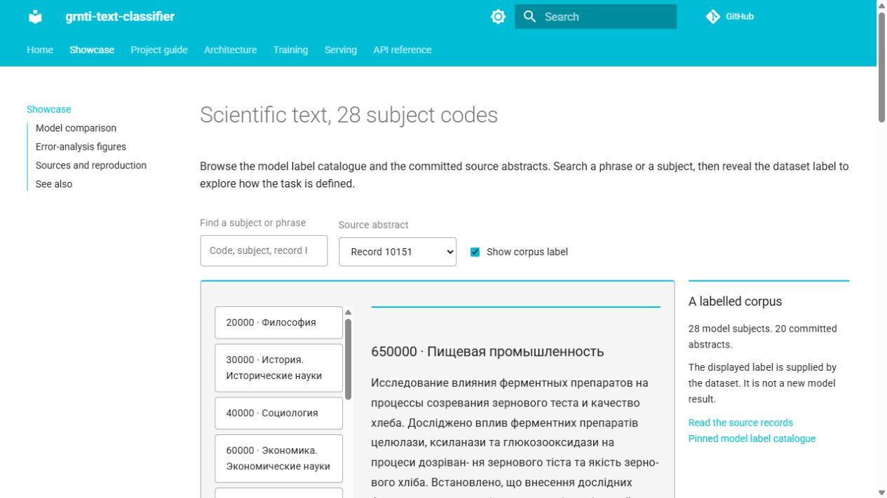

# Scientific-Text Classification

Classify scientific abstracts into 28 GRNTI subject codes. XLM-RoBERTa is the main model; ruBERT provides a second operating point.

[](https://github.com/kiselyovd/grnti-text-classifier/actions/workflows/test.yml) [](https://kiselyovd.github.io/grnti-text-classifier/) [](https://huggingface.co/kiselyovd/grnti-text-classifier) [](LICENSE)

[](https://kiselyovd.github.io/grnti-text-classifier/showcase/)

**[Browse the subjects and abstracts](https://kiselyovd.github.io/grnti-text-classifier/showcase/)** — search the 28-code catalogue, inspect the 20 committed source records, and reveal their corpus labels. Original code strings and text are preserved, including separate codes with matching names.

## Published operating points

<!-- ARTIFACT-MANIFEST:START -->
### Current artifact and evaluation

**Native checkpoint replay on 2,772 pinned source test abstracts**

| Metric | Value |
|---|---:|
| Top-1 accuracy | 72.37% |
| Top-5 accuracy | 96.75% |
| Macro F1 | 72.30% |

Current pinned source test split. Original training dataset revision and membership were not recorded; held-out independence is not re-established by this replay.

[Evaluation record](https://github.com/kiselyovd/grnti-text-classifier/blob/main/reports/replay-native.json) · [Pinned model](https://huggingface.co/kiselyovd/grnti-text-classifier/tree/24fbe75c27112612a464935c95465def6af788ef)
<!-- ARTIFACT-MANIFEST:END -->

Baseline ruBERT reports 72.9% top-1 / 95.9% top-5 / 72.8% macro F1 in the historical source card; its prediction arrays are unavailable. These operating points do not explain their difference.

**[Classify your own abstract](https://huggingface.co/spaces/kiselyovd/grnti-text-classifier-demo)** · [Browse the source corpus](https://kiselyovd.github.io/grnti-text-classifier/showcase/)

## Use the model

```python
from transformers import pipeline

classifier = pipeline("text-classification", model="kiselyovd/grnti-text-classifier",
    revision="24fbe75c27112612a464935c95465def6af788ef",
    trust_remote_code=False, top_k=5)
print(classifier("Исследование квантовой электродинамики в кристаллах.",
                 truncation=True, max_length=256))
```

Outputs use the model's original code/name label map. [Source abstracts](data/sample/sample.jsonl) · [Training and API setup](docs/project-guide.md#quick-start) · [Русский README](README.ru.md)

## Documentation

- [Corpus explorer](https://kiselyovd.github.io/grnti-text-classifier/showcase/)
- [Project guide](docs/project-guide.md): dataset, recipes, evaluation, and serving variables.
- [Architecture](docs/architecture.md) · [Training](docs/training.md) · [API serving](docs/serving.md)

## Limitations and terms

The classifier targets Russian scientific-text subject assignment. The smoke corpus preserves original multilingual source text and existing labels; the explorer presents those records rather than producing new predictions. Numerical per-class report arrays are absent from the tracked repository, so the published plots remain source-labelled figures.

Code is [MIT](LICENSE). Dataset and pretrained-model terms apply separately; see the [model card](https://huggingface.co/kiselyovd/grnti-text-classifier).
