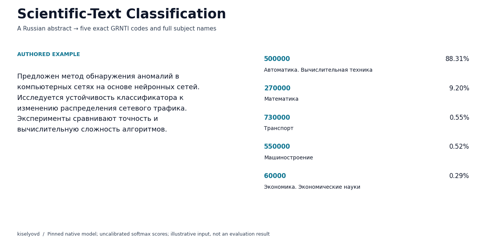

# Классификация научных текстов по ГРНТИ

XLM-RoBERTa относит русскоязычную научную аннотацию к одному из 28 кодов ГРНТИ и возвращает пять кандидатов с полными названиями разделов. ruBERT сохраняется как исторический baseline.

[CI](https://github.com/kiselyovd/grnti-text-classifier/actions/workflows/test.yml) · [Документация](https://kiselyovd.github.io/grnti-text-classifier/) · [Модель](https://huggingface.co/kiselyovd/grnti-text-classifier) · [Лицензии компонентов](docs/EVALUATION.md)

[](https://huggingface.co/spaces/kiselyovd/grnti-text-classifier-demo)

**[Классифицировать свою аннотацию](https://huggingface.co/spaces/kiselyovd/grnti-text-classifier-demo)** · [Каталог разделов и исходные примеры](https://kiselyovd.github.io/grnti-text-classifier/showcase/)

Опубликованные веса повторно оценены на закреплённом исходном test-split. [Актуальные метрики](README.md#current-artifact-and-evaluation) генерируются из [отчёта с logits, targets и source IDs](reports/replay-native.json). Историческая ревизия training-датасета и состав training-выборки не записаны; независимость этого test-split повторным запуском не устанавливается. Массивы предсказаний ruBERT не восстановлены.

## Попробовать

```python
from transformers import pipeline
classifier = pipeline(
    "text-classification", model="kiselyovd/grnti-text-classifier",
    revision="24fbe75c27112612a464935c95465def6af788ef",
    trust_remote_code=False, top_k=5,
)
print(classifier("Исследование квантовой электродинамики в кристаллах.",
                 truncation=True, max_length=256))
```

Коды сохраняются как исходные строки, включая отдельные коды с одинаковыми названиями. Softmax-score не калиброван. Вход ограничен 256 токенами; Space сообщает об усечении текста.

## Документация

[Установка и обучение](docs/project-guide.md) · [API](docs/serving.md) · [Протокол оценки и условия компонентов](docs/EVALUATION.md) · [Английский README](README.md) · [Цитирование](CITATION.cff)

Код MIT; условия исходных данных и базовых моделей применяются отдельно. Примеры и интерактивный просмотрщик помогают изучать задачу и ошибки, а не заменяют оценку на зафиксированном наборе.
