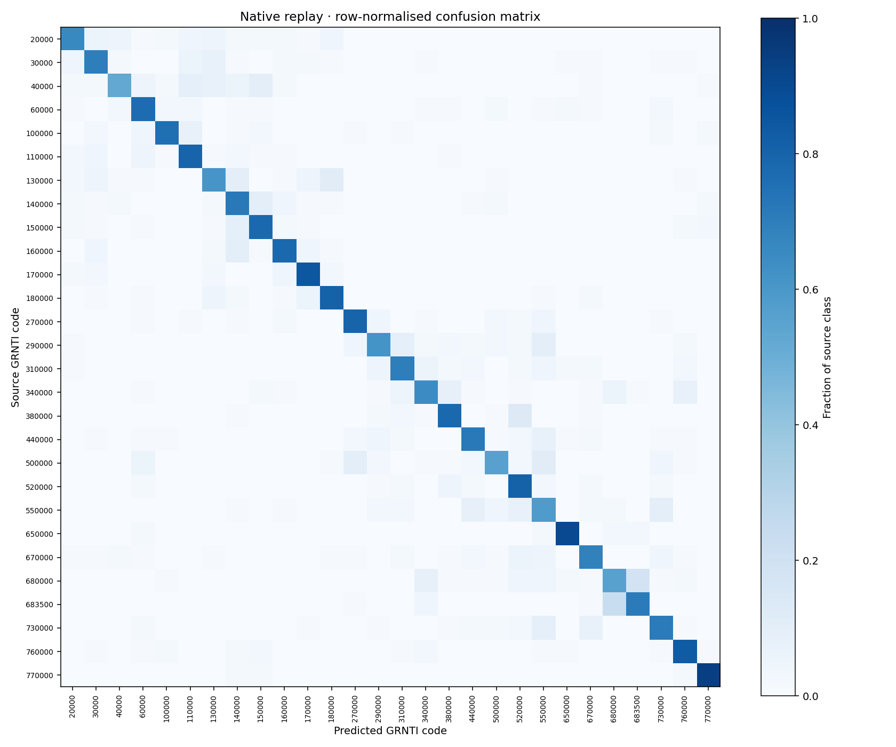
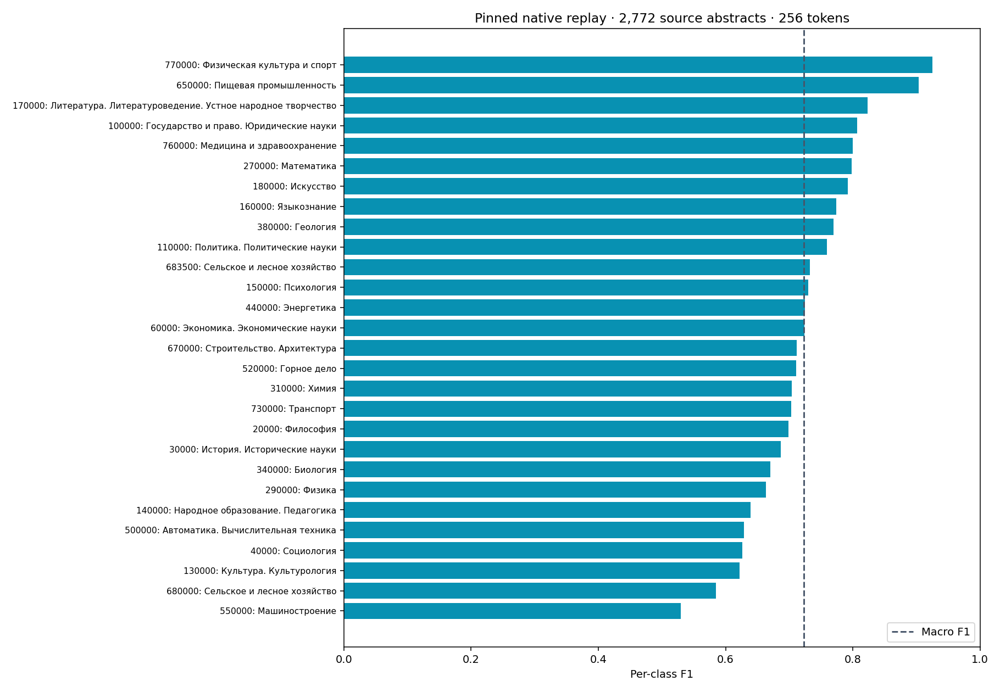

[Back to overview](index.md) · [Interactive showcase](showcase.md)

# Project guide

## Dataset

[ai-forever/ru-scibench-grnti-classification](https://huggingface.co/datasets/ai-forever/ru-scibench-grnti-classification) - Russian scientific abstracts labelled with 28 GRNTI top-level sections. Split statistics:

| Split | Rows | Classes |
|-------|-----:|--------:|
| Train | 28 476 | 28 (balanced) |
| Test  | 2 772 | 28 (balanced) |

Median sequence length ~120 tokens under the XLM-RoBERTa tokenizer (`xlm-roberta-base`, `max_length=256`). Fetched by `scripts/sync_data.sh` via HF `snapshot_download`.

## Results

Test set n = 2 772 abstracts across 28 GRNTI sections.

| Model | Top-1 accuracy | Top-5 accuracy | Macro F1 | Weighted F1 |
|-------|---------------:|---------------:|---------:|------------:|
| **XLM-RoBERTa-base (main)** | **72.4%** | **96.8%** | **72.3%** | **72.3%** |
| ruBERT-base-cased (baseline) | 72.9% | 95.9% | 72.8% | 72.8% |

Best Optuna trial (20 trials, val macro-F1): `lr=3.1e-5, weight_decay=0.012, warmup_ratio=0.147` → val macro-F1 = 73.1%.

ruBERT reports slightly higher top-1 accuracy; XLM-RoBERTa reports slightly higher top-5 accuracy. These are different operating points; the comparison alone does not identify why the difference occurs.

## Visualizations



XLM-RoBERTa-base confusion matrix over the 28 GRNTI sections (test set, n = 2 772). Strong diagonal with off-diagonal mass concentrated between semantically adjacent sections.



Per-class F1 across all 28 GRNTI sections, ranked. Highlights the spread between well-separated and harder, overlapping classes that drive the 72.3% macro-F1.

## Quick Start

```bash
uv sync --all-groups
bash scripts/sync_data.sh
uv run python -m grnti_text_classifier.data.prepare --raw data/raw --out data/processed
uv run python scripts/train_all.py
```

## Serving

```bash
uvicorn grnti_text_classifier.serving.main:app --reload
```

Classify a text:

```bash
curl -X POST http://localhost:8000/classify \
  -H "Content-Type: application/json" \
  -d '{"text":"Исследование квантовой электродинамики в кристаллах."}'
```

See [docs/serving.md](serving.md) for full endpoint contracts, all request/response schemas, and environment variable reference.

## Environment Variables

| Variable | Purpose |
|----------|---------|
| `GRNTI_MAIN_DIR` | Directory containing the `save_pretrained` snapshot for XLM-RoBERTa main model. |
| `GRNTI_BASELINE_DIR` | Directory containing the `save_pretrained` snapshot for ruBERT baseline. |
| `GRNTI_LABEL_ENCODER` | Path to `label_encoder.json` mapping int indices to GRNTI class codes. |
| `GRNTI_MODEL_VERSION` | Reported in `/health` response and classification output (e.g. `v0.1.0`). |

## Docs

Full documentation (architecture, training runbook, serving guide, API reference) is published at **[https://kiselyovd.github.io/grnti-text-classifier/](https://kiselyovd.github.io/grnti-text-classifier/)**.

## License

MIT - see [LICENSE](https://github.com/kiselyovd/grnti-text-classifier/blob/main/LICENSE).

## See also

- [Training](training.md)
- [Serving](serving.md)
- [Architecture](architecture.md)
